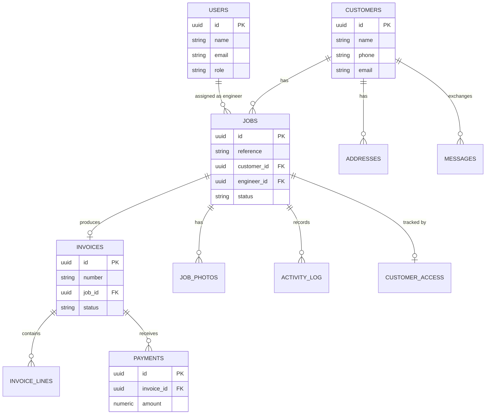

# 03 — Data model

Deliberately small for the MVP. Five core entities plus supporting tables. Postgres assumed.

## 1. Entity overview (ERD)



## 2. Tables & fields

### users  (admin + engineers)
| Field | Type | Notes |
|---|---|---|
| id | uuid (PK) | |
| name | text | |
| email | text (unique) | login |
| phone | text | |
| role | enum `admin` / `engineer` | |
| password_hash | text | argon2/bcrypt |
| is_active | boolean | default true |
| created_at / updated_at | timestamptz | |

### customers
| Field | Type | Notes |
|---|---|---|
| id | uuid (PK) | |
| name | text | required |
| phone | text | |
| email | text | |
| notes | text | |
| created_at / updated_at | timestamptz | |

### addresses
| Field | Type | Notes |
|---|---|---|
| id | uuid (PK) | |
| customer_id | uuid (FK→customers) | |
| line1 / line2 / city / postcode | text | |
| is_primary | boolean | |

### jobs
| Field | Type | Notes |
|---|---|---|
| id | uuid (PK) | |
| reference | text (unique) | e.g. `JOB-0142`, generated |
| customer_id | uuid (FK→customers) | |
| address_id | uuid (FK→addresses) | site address |
| engineer_id | uuid (FK→users, null) | assigned engineer |
| title | text | |
| description | text | |
| priority | enum `low`/`normal`/`urgent` | |
| status | enum (see workflows) | default `new` |
| quoted_amount | numeric(10,2) | optional |
| scheduled_start | timestamptz | |
| scheduled_end | timestamptz | |
| signoff_name | text | captured at completion |
| signoff_signature | text/url | data URL or stored image |
| completed_at | timestamptz | |
| created_at / updated_at | timestamptz | |

### job_photos
| Field | Type | Notes |
|---|---|---|
| id | uuid (PK) | |
| job_id | uuid (FK→jobs) | |
| url | text | storage URL |
| caption | text | |
| uploaded_by | uuid (FK→users) | |
| created_at | timestamptz | |

### invoices
| Field | Type | Notes |
|---|---|---|
| id | uuid (PK) | |
| number | text (unique, sequential) | UK requirement |
| job_id | uuid (FK→jobs) | |
| customer_id | uuid (FK→customers) | denormalised for convenience |
| status | enum `draft`/`sent`/`overdue`/`paid`/`void` | |
| issue_date | date | |
| due_date | date | issue + payment terms |
| subtotal | numeric(10,2) | |
| vat_rate | numeric(5,2) | |
| vat_amount | numeric(10,2) | |
| total | numeric(10,2) | |
| payment_reference | text | = job/invoice number |
| pdf_url | text | generated |
| sent_at / paid_at | timestamptz | |
| created_at / updated_at | timestamptz | |

### invoice_lines
| Field | Type | Notes |
|---|---|---|
| id | uuid (PK) | |
| invoice_id | uuid (FK→invoices) | |
| description | text | |
| quantity | numeric(10,2) | |
| unit_price | numeric(10,2) | |
| line_total | numeric(10,2) | qty × unit_price |

### payments
| Field | Type | Notes |
|---|---|---|
| id | uuid (PK) | |
| invoice_id | uuid (FK→invoices) | |
| amount | numeric(10,2) | |
| paid_on | date | |
| reference | text | bank ref seen |
| note | text | |
| recorded_by | uuid (FK→users) | |
| created_at | timestamptz | |

### customer_access  (tokenised portal link per job)
| Field | Type | Notes |
|---|---|---|
| id | uuid (PK) | |
| job_id | uuid (FK→jobs) | |
| token | text (unique) | unguessable; used in `/track/{token}` |
| short_code | text | human-friendly backup code |
| expires_at | timestamptz | nullable |
| created_at | timestamptz | |

### messages  (Phase 2)
| Field | Type | Notes |
|---|---|---|
| id | uuid (PK) | |
| customer_id | uuid (FK→customers) | |
| job_id | uuid (FK→jobs, null) | |
| direction | enum `inbound`/`outbound` | |
| channel | enum `email`/`sms`/`portal` | |
| body | text | |
| status | enum `draft`/`sent`/`received`/`failed` | |
| created_at | timestamptz | |

### activity_log
| Field | Type | Notes |
|---|---|---|
| id | uuid (PK) | |
| job_id | uuid (FK→jobs, null) | |
| invoice_id | uuid (FK→invoices, null) | |
| actor_id | uuid (FK→users, null) | null = system |
| action | text | e.g. `status_changed` |
| detail | jsonb | `{from, to, note}` |
| created_at | timestamptz | |

### company_settings  (single row)
| Field | Type | Notes |
|---|---|---|
| id | uuid (PK) | |
| company_name / address / phone / email | text | |
| vat_number | text | |
| default_vat_rate | numeric(5,2) | |
| logo_url | text | |
| bank_account_name / bank_sort_code / bank_account_number | text | shown on invoices |
| invoice_prefix | text | e.g. `INV-` |
| invoice_next_number | int | sequential counter |
| job_prefix | text | e.g. `JOB-` |
| payment_terms_days | int | e.g. 14 |

## 3. Enums
- `user_role`: `admin`, `engineer`
- `job_priority`: `low`, `normal`, `urgent`
- `job_status`: `new`, `scheduled`, `en_route`, `on_site`, `on_hold`, `completed`, `invoiced`, `paid`, `closed`, `cancelled`
- `invoice_status`: `draft`, `sent`, `overdue`, `paid`, `void`
- `message_direction`: `inbound`, `outbound`
- `message_channel`: `email`, `sms`, `portal`

## 4. Conventions
- All tables have `created_at`; mutable tables also `updated_at`.
- Use soft deletes (`deleted_at`) for customers, jobs, invoices — never hard-delete financial/customer records.
- Monetary values stored as `numeric(10,2)`; never floats.
- Generate `jobs.reference` and `invoices.number` server-side from `company_settings` counters (transactional, no gaps where the law requires sequential invoice numbers).

## 5. Example SQL (core Phase 1 tables)

```sql
create type user_role   as enum ('admin','engineer');
create type job_status  as enum ('new','scheduled','en_route','on_site','on_hold',
                                 'completed','invoiced','paid','closed','cancelled');
create type job_priority as enum ('low','normal','urgent');
create type invoice_status as enum ('draft','sent','overdue','paid','void');

create table users (
  id uuid primary key default gen_random_uuid(),
  name text not null,
  email text unique not null,
  phone text,
  role user_role not null default 'engineer',
  password_hash text,
  is_active boolean not null default true,
  created_at timestamptz not null default now(),
  updated_at timestamptz not null default now()
);

create table customers (
  id uuid primary key default gen_random_uuid(),
  name text not null,
  phone text,
  email text,
  notes text,
  deleted_at timestamptz,
  created_at timestamptz not null default now(),
  updated_at timestamptz not null default now()
);

create table addresses (
  id uuid primary key default gen_random_uuid(),
  customer_id uuid not null references customers(id),
  line1 text, line2 text, city text, postcode text,
  is_primary boolean not null default false
);

create table jobs (
  id uuid primary key default gen_random_uuid(),
  reference text unique not null,
  customer_id uuid not null references customers(id),
  address_id uuid references addresses(id),
  engineer_id uuid references users(id),
  title text not null,
  description text,
  priority job_priority not null default 'normal',
  status job_status not null default 'new',
  quoted_amount numeric(10,2),
  scheduled_start timestamptz,
  scheduled_end timestamptz,
  signoff_name text,
  signoff_signature text,
  completed_at timestamptz,
  deleted_at timestamptz,
  created_at timestamptz not null default now(),
  updated_at timestamptz not null default now()
);

create table invoices (
  id uuid primary key default gen_random_uuid(),
  number text unique not null,
  job_id uuid not null references jobs(id),
  customer_id uuid not null references customers(id),
  status invoice_status not null default 'draft',
  issue_date date not null default current_date,
  due_date date,
  subtotal numeric(10,2) not null default 0,
  vat_rate numeric(5,2) not null default 0,
  vat_amount numeric(10,2) not null default 0,
  total numeric(10,2) not null default 0,
  payment_reference text,
  pdf_url text,
  sent_at timestamptz,
  paid_at timestamptz,
  created_at timestamptz not null default now(),
  updated_at timestamptz not null default now()
);

create table invoice_lines (
  id uuid primary key default gen_random_uuid(),
  invoice_id uuid not null references invoices(id) on delete cascade,
  description text not null,
  quantity numeric(10,2) not null default 1,
  unit_price numeric(10,2) not null default 0,
  line_total numeric(10,2) not null default 0
);

create table payments (
  id uuid primary key default gen_random_uuid(),
  invoice_id uuid not null references invoices(id),
  amount numeric(10,2) not null,
  paid_on date not null default current_date,
  reference text,
  note text,
  recorded_by uuid references users(id),
  created_at timestamptz not null default now()
);

create table customer_access (
  id uuid primary key default gen_random_uuid(),
  job_id uuid not null references jobs(id),
  token text unique not null,
  short_code text not null,
  expires_at timestamptz,
  created_at timestamptz not null default now()
);

create table activity_log (
  id uuid primary key default gen_random_uuid(),
  job_id uuid references jobs(id),
  invoice_id uuid references invoices(id),
  actor_id uuid references users(id),
  action text not null,
  detail jsonb,
  created_at timestamptz not null default now()
);
```
